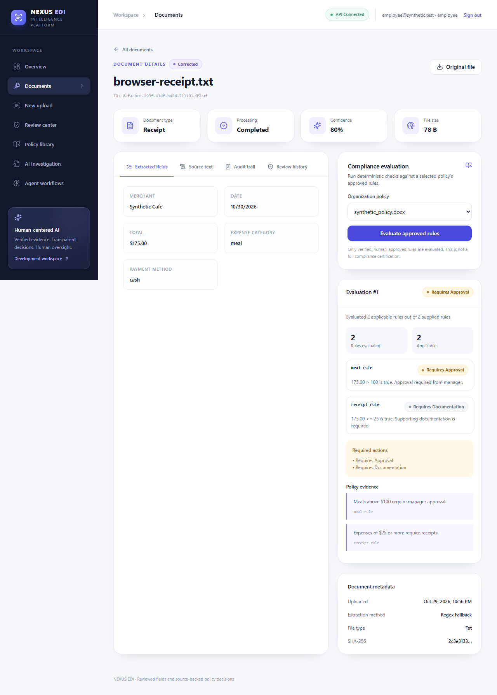
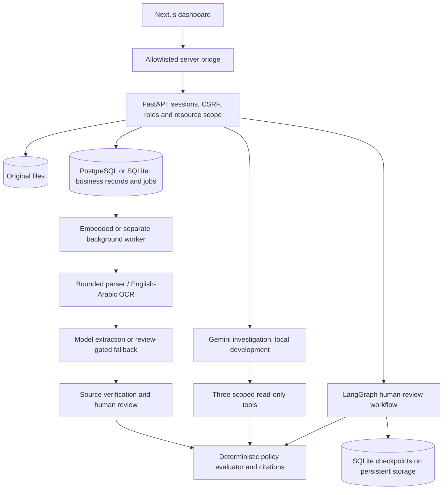

# Enterprise Document Intelligence (EDI)

**AI-assisted document review and source-backed expense-policy checks.**

EDI turns uploaded business documents into reviewed structured data, checks that data
against verified company rules, and explains the result with original-source evidence.
It combines FastAPI, a Next.js dashboard, bounded Gemini investigation tools,
LangGraph human-review checkpoints and durable background processing.

**Status — October 30, 2026:** milestones 1–4 implemented and locally verified;
milestone 4 awaits review.
**Showcase target — November 6, 2026:** cooperating specialists and broader evaluation remain planned.
Production readiness has separate gates.

[Architecture](docs/ARCHITECTURE.md) · [Verification evidence](docs/VERIFICATION.md) ·
[Detailed roadmap](docs/ROADMAP.md) · [Security](docs/SECURITY.md) ·
[Engineering decisions](docs/DECISIONS.md)

## The business workflow

Consider a **$175 restaurant receipt** and a policy stating:
“Meals above $100 require manager approval.”

1. A reviewer uploads the policy. AI proposes supported numeric expense rules in one
   bounded whole-policy pass; each candidate is independently checked against its source.
2. The reviewer inspects the quotations and approves individual rules or confirms an
   explicit batch. Model output alone cannot activate a rule.
3. An employee uploads the receipt. A background worker extracts text, classifies the
   document and attempts structured extraction; failures have bounded retries.
4. A reviewer checks/corrects the fields. Original extraction provenance and review
   history remain available.
5. The deterministic evaluator compares the reviewed amount against approved rules and
   returns **manager approval required**, with the supporting policy quotation.
6. In local development, authorized users can ask the Gemini agent to investigate the
   selected document/policy through restricted tools and inspect its evidence.

Document-field review and policy-rule approval are distinct from expense approval.
EDI does not approve reimbursements, execute payments or certify complete compliance.



*Synthetic policy-evaluation scenario verified in Milestone 2. Milestone 3 adds
background processing and persistence.*

## Engineering focus and current scope

- **Separate generation from authority.** AI proposes fields/rules and selects tools;
  source verification, human review and deterministic Python establish official outcomes.
- **Authorize at each boundary.** Sessions, CSRF, roles and organization/ownership checks
  protect APIs, originals, citations, workers and tools. Negative tests exercise denial paths.
- **Recover interrupted work.** Database jobs use bounded attempts, expiring claims and
  transactional completion fencing; stale workers cannot commit results. LangGraph
  persists human-review checkpoints and rechecks resource access on resume.
- **Keep infrastructure proportionate.** A database queue avoids an extra broker for
  this single-host scope; a compact profile embeds the worker. The current SQLite
  checkpoint scaling limit and other trade-offs are recorded in [ADRs](docs/DECISIONS.md).

| Area | Current implementation | Boundary / next step |
|---|---|---|
| Intake and extraction | Bounded PDF, DOCX, PPTX, UTF-8 TXT and image intake; OCR; heuristic classification; configured-model extraction and review-gated fallback | Accuracy is not established by functional tests; tables/scans need broader evaluation |
| Policy checking | Automatic candidates, source verification, confirmed human decisions and cited deterministic evaluation | Current verifier supports a narrow set of English monetary expense statements |
| Identity and UI | Session login/logout, Employee/Reviewer/Admin roles, scoped accounts, admin-managed names, personal statistics, password changes and audit history | SSO/MFA/account recovery and independent security review remain production work |
| Investigation | Existing bounded Gemini agent with three scoped read-only tools and account-derived resource selection | Local development only; cooperating specialists are milestone 5 work |
| Workflows | LangGraph human-review interruption, persistence and resume | Full orchestration/status/trace UI is planned for milestone 5 |
| Reliability | PostgreSQL/SQLite business storage, Alembic, safe backup-import rehearsal, durable jobs, processing UI and retry | Single-host design; production backup/restore and load/SLO verification remain |
| Containers | Frontend/API/worker/PostgreSQL, private backend networking, loopback UI, readiness, volumes and normal/compact profiles | Both profiles passed local build/start/restart checks; public deployment is not certified |
| Arabic | Unicode preservation, native TXT/DOCX checks, bilingual OCR configuration and automatic source-text direction | Arabic semantic extraction, policy verification and measured OCR accuracy remain required work |
| Retrieval | Authorized policy search, optional pinned multilingual ONNX encoder, BM25/cosine/RRF, exact quotations and scoped index lifecycle | Synthetic benchmark: 87.5% Recall@5; Arabic unanswerable abstention only 50% (2/4); candidate sources, never decisions |
| MLOps | Automated security/integration/browser/container checks and reproducible retrieval benchmark | Broader extraction/agent evaluation and operational telemetry remain planned |

The worker executes queued jobs; the existing Gemini agent chooses permitted investigation
tools. Specialist coordination is planned for milestone 5. See
[Arabic acceptance](docs/ARABIC_SUPPORT.md) for the remaining bilingual requirements.

See [retrieval setup, metrics and limitations](docs/RETRIEVAL.md) to enable the optional
267 MB local encoder. Default search is explicitly keyword-only; no request-time model
downloads. Older policies need indexing; new uploads queue it automatically.

## Architecture



| Layer | Technology / responsibility |
|---|---|
| Frontend | Next.js App Router, React, TypeScript, Tailwind CSS, TanStack Query |
| Backend | Python 3.12, FastAPI, Pydantic, SQLAlchemy, Alembic |
| AI and workflows | Gemini/configurable extraction provider, restricted Python tools, LangGraph |
| Processing | Tesseract `eng+ara`, Poppler, format-specific parsers, bounded subprocesses |
| Persistence | PostgreSQL through psycopg; optional SQLite; persistent originals and SQLite workflow checkpoints |
| Execution and delivery | Database-backed queue, Docker Compose, compact profile, GitHub Actions definitions |
| Verification | pytest, Ruff, TypeScript/build gates, Playwright, real PostgreSQL and container restart checks |

## Delivery timeline

Completed rows use observed verification dates. Future windows are planning targets,
subject to review and quality gates; the showcase date is not a production-release promise.

| Milestone | Date / target window | Status | Measurable outcome |
|---|---|---|---|
| **1 — Trustworthy lifecycle** | Verified Oct 30, 2026 | Complete | Shared review/eligibility gates across API, tools and workflows; unsafe model-led official validation retired; durable review/resume checks |
| **2 — Identity and security** | Verified Oct 30, 2026 | Complete | Real sessions/CSRF/RBAC, ownership isolation, bounded intake, source-verified rule review, account/profile flows and investigation authorization tests |
| **3 — Persistence and recovery** | Verified Oct 30, 2026 | Complete | Real PostgreSQL and safe synthetic import; queued uploads/recovery/fencing; both Docker profiles built/started/restarted; authenticated HTTP intake and checkpoint/session/original persistence |
| **4 — Authorized evidence retrieval** | Nov 2–3, 2026 | Planned | Tenant-scoped hybrid search, indexing/deletion and at least 30 labeled queries, including 15 Arabic; report Recall@5, MRR, citation support and abstention by language |
| **5 — Cooperating specialists and bilingual understanding** | Nov 3–4, 2026 | Planned | Distinct document/policy responsibilities, bounded durable coordination and workflow UI; at least 20 Arabic and 20 English fixtures; verified Arabic interpretation, outage/injection/replay tests and single-agent comparison |
| **6 — MLOps and release checks** | Nov 5, 2026 | Planned | Correlated/redacted logs, latency/error/token/cost measurements, language-specific OCR/field/rule/retrieval evaluation and release CI gates |
| **7 — Employer showcase** | Nov 6, 2026 | Planned | Independent clean-start rehearsal, complete English/Arabic investigation scenario, evidence/audit/restart demonstration, screenshots, demo script and evidence-supported CV claims |

The showcase must demonstrate the integrated lifecycle, genuine specialist cooperation,
measured quality and reproducible setup. Release progress depends on passing acceptance
criteria; deferred scope will be documented explicitly.

### Production readiness after the showcase

| Track | Required acceptance before a production claim |
|---|---|
| Identity and security | Threat model, independent authorization/upload security review, SSO/MFA/recovery strategy and appropriate deployment controls |
| Data operations | Retention/deletion policy, managed secrets, tested backups and restore, migration/rollback rehearsal and operational runbooks |
| Deployment and scale | HTTPS, controlled release/rollback, sustained load against defined SLOs, alerting and a justified availability/checkpoint-scaling strategy |
| Model quality | Broader representative English/Arabic corpora, measured failure/abstention rates, drift monitoring and reproducible model/configuration comparisons |

These tracks are gate-based and currently unscheduled. See the [full roadmap](docs/ROADMAP.md)
and [security contract](docs/SECURITY.md) for acceptance details and remaining risks.

## Verification evidence

Results are recorded as of October 30, 2026; verification uses synthetic data and no real model calls.

| Check | Observed result |
|---|---|
| Full backend suite | **296 passed, 8 skipped**; skips are opt-in PostgreSQL tests without a supplied dedicated cluster |
| Dedicated PostgreSQL suite | **8 passed** in a separate isolated run, including migrations, authorization, import and recovery |
| Playwright runner | **13 passed**: four browser journeys, eight gateway checks and one gateway-to-real-backend investigation with synthetic model generation |
| Clean Linux containers | Backend dependency installation/`pip check` and Node 22 TypeScript/production build passed |
| Container integration | Both normal and compact profiles passed startup, real authenticated HTTP upload, worker processing and full-service restart/persistence checks |
| Static/config checks | Ruff, Compose validation and `git diff --check` passed |

GitHub Actions defines backend, frontend/browser, PostgreSQL and container jobs.
Current remote run results are available in [Actions](https://github.com/Z4iM/enterprise-document-intelligence/actions).
Model accuracy, Arabic OCR CER/WER, live Gemini cost and sustained load have **not** been
benchmarked yet. Passing synthetic functional tests is not an accuracy benchmark.
Commands, fixture scope, dated results and limitations: [VERIFICATION.md](docs/VERIFICATION.md).

## Run locally

### Docker Compose

Requirements: Docker Engine with Compose. The credential-generation helper uses Python;
Docker Desktop with its Linux backend is the locally verified Windows setup.

From the repository root, for a fresh local environment:

```powershell
python scripts/init_local_secrets.py
docker compose up --build
```

In a second terminal, bootstrap the first administrator **only for a fresh database**:

```powershell
docker compose exec api python -m app.auth.bootstrap --email admin@edi.test
```

Bootstrap prompts for your own 12–128 character password; there are no shipped login
credentials. Open [the dashboard](http://127.0.0.1:3000), sign in and create local Employee/
Reviewer accounts through **Users**. Only the frontend is published; API/DB stay private.
Named volumes retain records, originals and checkpoints across restarts.

Compose defaults to **disabled inference**: document processing uses review-gated fallback,
and automatic AI policy-rule extraction requires a separately configured provider.
The investigation gateway is intentionally unavailable in production frontend builds,
including Docker. Use native development below to exercise that agent.

The compact configuration runs the worker inside the API:

```powershell
docker compose -f compose.yaml -f compose.compact.yaml up --build
```

Normal/compact steady memory caps total approximately 1.9/1.4 GiB; workload requirements
remain unmeasured. Do not use `down --volumes` on valued data.
See [startup, persistence and safe import](docs/PERSISTENCE.md).

<details>
<summary>Native Windows setup and local Gemini investigation</summary>

### Native Windows development

Use Python **3.12** and Node **22**. Create a virtual environment only if absent, then:

```powershell
python -m venv .venv
.\.venv\Scripts\python.exe -m pip install -r requirements-ci.txt
cd frontend
npm ci
cd ..
```

Choose a new demo database; keep the same environment for migration, bootstrap and server:

```powershell
$env:PYTHON_DOTENV_DISABLED = '1'
$env:EDI_ENV = 'development'
$env:EDI_DATABASE_URL = 'sqlite:///data/edi-demo.db'
$env:EDI_ALLOWED_ORIGINS = 'http://127.0.0.1:3000,http://127.0.0.1:8000'
$env:LLM_PROVIDER = 'disabled'
.\.venv\Scripts\python.exe -m alembic upgrade head
.\.venv\Scripts\python.exe -m app.auth.bootstrap --email admin@edi.test
.\.venv\Scripts\python.exe -m uvicorn app.main:app --host 127.0.0.1 --port 8000
```

In another terminal, run `npm run dev` from `frontend` and open
[127.0.0.1:3000](http://127.0.0.1:3000). The embedded worker starts with FastAPI.

For local HTTP login, the **backend terminal** must keep `EDI_ENV=development` and
the allowed loopback origins above, even when Next.js uses a production build. A 503
`Configure HTTPS application origins.` means the backend is requiring HTTPS; it does
not mean Next.js is offline. `/ready` returning `Database migrations required.` is a
separate issue: back up the configured database and migrate it using the same database
environment as the server. Do not change database URLs or bootstrap another account
as a workaround; an unsigned `/auth/me` returning 401 is expected.
OCR needs Tesseract with `eng` and `ara` packs; scanned PDFs also need Poppler on PATH.
TXT/native DOCX processing needs neither binary nor a GPU. Backend API documentation is
at [127.0.0.1:8000/docs](http://127.0.0.1:8000/docs). `/health` is liveness; `/ready`
checks DB connectivity/migration head, not model quality.

Runtime pins are in `requirements-runtime.txt`; CI requirements add test tools.
`requirements.txt` additionally includes the heavier experimental retrieval stack.
The frontend uses `package-lock.json`. Variable names are documented in `.env.example`
and `frontend/.env.example`; preserve private configuration and never put credentials
in `NEXT_PUBLIC_*` variables.

### Local Gemini investigation

With a privately configured extraction provider, the normal UI supports policy upload,
pending rules, explicit approval and document review. Gemini investigation additionally
requires these **server-only** settings:

| Backend | Frontend development server |
|---|---|
| `EDI_ENABLE_DEV_AGENT=true` | `EDI_ENABLE_DEV_AGENT_FRONTEND=true` |
| `EDI_DEV_AGENT_TOKEN` — strong random shared secret | The same `EDI_DEV_AGENT_TOKEN` |
| Valid `GEMINI_API_KEY` and `GEMINI_MODEL` | No browser-exposed API key |

For Gemini-backed field/policy extraction, set backend `LLM_PROVIDER=gemini` with your
private provider configuration. The disabled-inference quick start cannot generate AI rules.

Restart the backend on loopback and use `npm run dev` at `http://127.0.0.1:3000`.
Select authorized documents/policies by filename; account permissions supply scope,
without manual ID environment lists. Official outcomes require explicitly reviewed fields
and verified, human-approved rules. Live requests consume provider quota; use synthetic
documents. Automated verification substitutes generation and makes no real LLM calls.

`npm run build` / `npm start` exercises the local production frontend; normal business
APIs work, but investigation remains disabled by its development guard. Local HTTP still
requires backend `EDI_ENV=development`. Do not override `NODE_ENV` or weaken the guards.
See [frontend/README.md](frontend/README.md) for routes and account/profile behavior.

</details>

## Reproduce checks

```powershell
.\.venv\Scripts\python.exe -m ruff check .
.\.venv\Scripts\python.exe -m pytest -q
cd frontend
npm run lint
npm run build
$env:EDI_BROWSER_CHANNEL = 'msedge'
npm run test:e2e
cd ..
.\.venv\Scripts\python.exe scripts/verify_compose.py
.\.venv\Scripts\python.exe scripts/verify_containers.py
git diff --check
```

`npm run lint` currently runs TypeScript, not ESLint. Playwright uses one worker,
isolated synthetic accounts/databases and loopback ports 3197/8197; it refuses to reuse
existing servers. Edge was verified locally; CI configures Chromium. The container runner
uses separate synthetic projects/volumes and stops them afterward. It does not reset
your application database. See [verification](docs/VERIFICATION.md) for dedicated PostgreSQL
commands and [persistence](docs/PERSISTENCE.md) for retained test artifacts.

## Data safety and known limits

- Business storage defaults to `data/database.db`, originals to `data/uploads` and
  `data/policies`, checkpoints to `data/langgraph_checkpoints.sqlite`; `EDI_DATABASE_URL`
  and `EDI_DATA_ROOT` configure alternatives. Docker uses its own named volumes.
- Native schema upgrades are explicit. Before adopting existing data, back up the DB,
  originals and checkpoints, rehearse on a separate copy and follow the
  [safe import procedure](docs/PERSISTENCE.md). Legacy ownership is quarantined rather
  than assigned automatically; rollback requires a reviewed compatible backup.
- Production cookies require configured HTTPS origins; local HTTP requires explicit
  `EDI_ENV=development`. A local production frontend build is not a public deployment.
- File/page/time limits and parser subprocesses are not an OS security sandbox.
  Retention, independent security review, production restore and load testing remain open.
- Experimental global FAISS retrieval is outside official evaluation and is not tenant-safe.
  Authorized hybrid retrieval is milestone 4 work; do not index valued data with the legacy script.
- General policy understanding and complete Arabic semantics remain unfinished.
  Unsupported evidence must stay review-gated; model fluency alone cannot establish authority.

For implementation details, start with [ARCHITECTURE.md](docs/ARCHITECTURE.md),
[DECISIONS.md](docs/DECISIONS.md), [API contract](frontend/docs/API_CONTRACT.md) and
[CHANGELOG.md](CHANGELOG.md).
