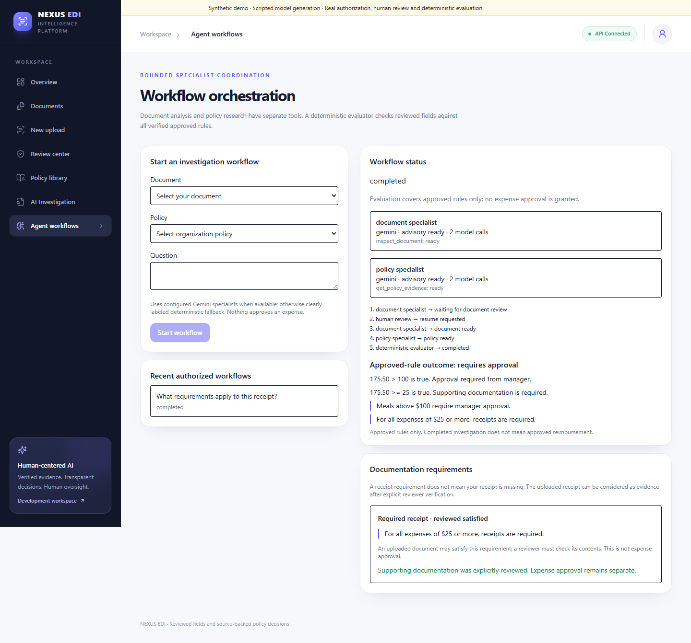
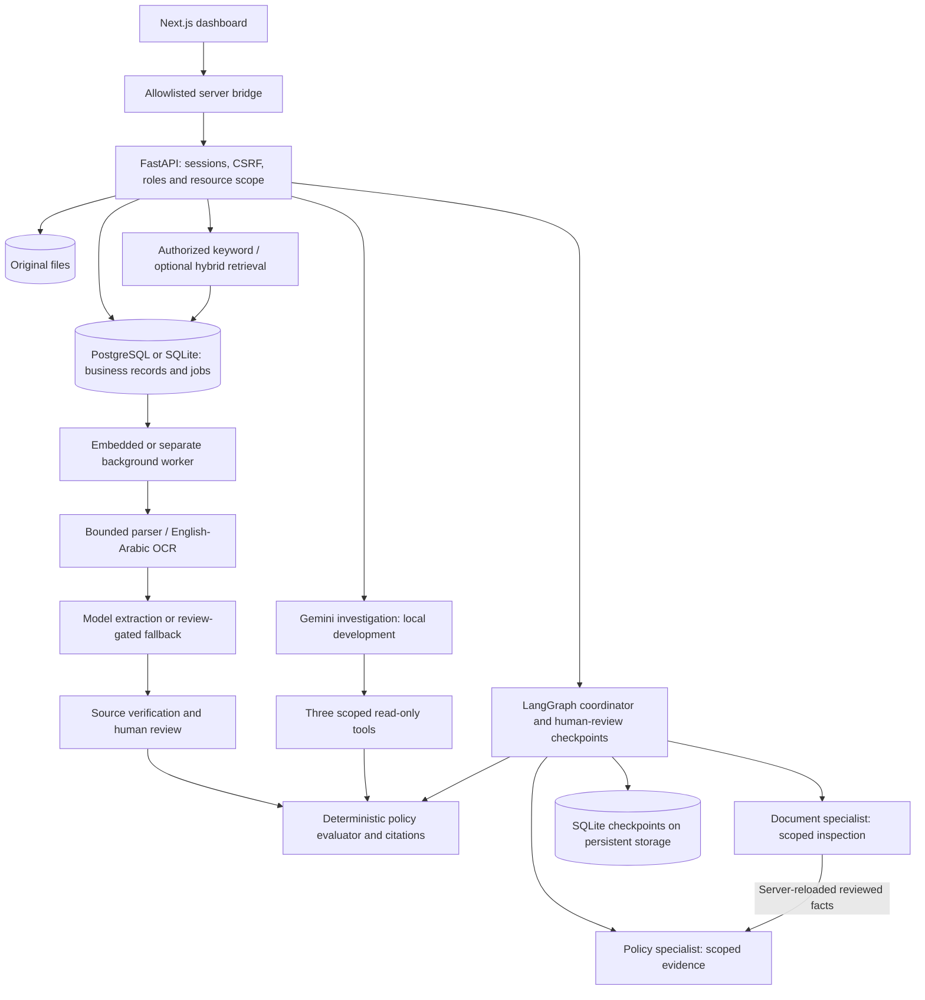

# NEXUS EDI

**Enterprise Document Intelligence**

**From raw documents to traceable policy requirements—with human review at every important checkpoint.**

NEXUS EDI connects document ingestion, reviewed structured data, policy evidence and
bounded AI investigation in one application. Its central engineering decision is simple:
models propose and investigate; source verification, human review and deterministic
Python determine official policy outcomes.

Built with **FastAPI · Next.js · Gemini · LangGraph · PostgreSQL · Docker**.

[](https://github.com/Z4iM/enterprise-document-intelligence/actions/workflows/ci.yml)

[Quick start](#run-locally) · [Documentation](docs/README.md) ·
[Architecture](docs/ARCHITECTURE.md) · [Verification](docs/VERIFICATION.md) ·
[Demo](docs/SHOWCASE.md) · [Roadmap](docs/ROADMAP.md)

## See the workflow

An employee uploads a **$175.50 receipt**. The approved policy says:
“Meals above $100 require manager approval.”

1. A background worker extracts and classifies the document and proposes structured fields.
2. A reviewer checks the original and corrects the fields; extraction provenance is retained.
3. Policy upload automatically proposes rules across the document. A reviewer inspects
   the source quotations and approves rules individually or confirms a batch.
4. The evaluator applies the verified, approved rules to explicitly reviewed data.
5. The result explains **manager approval required**, with the original policy quotation.
6. The local investigation and specialist workflow expose scoped tools, review pauses,
   resumable checkpoints and the evidence behind that requirement.

**Field review is not expense approval.** The application does not grant reimbursement,
execute payments or certify complete compliance. Previously approved rules that fail
current source verification block official decisions until the evidence is reviewed.

[](docs/demo/screenshots/en-workflow-desktop.png)

Actual application capture with scripted generation. Explore the
[Arabic desktop](docs/demo/screenshots/ar-workflow-desktop.png),
[Arabic mobile](docs/demo/screenshots/ar-workflow-mobile.png),
[policy review](docs/demo/screenshots/ar-policy-review.png),
[audit trail](docs/demo/screenshots/en-audit.png) and
[operations](docs/demo/screenshots/en-operations.png) captures.

## What to inspect as an engineer

- **Authority boundaries:** shared document eligibility, source-verified rules,
  explicit reviewer decisions and deterministic final evaluation.
- **Controlled agents:** an investigation agent and separate document/policy specialists
  with bounded tools; server-derived permissions are rechecked at each boundary.
- **Recovery:** database-backed jobs, expiring leases, completion fencing and durable
  LangGraph review checkpoints, including full-service restart verification.
- **Evaluation:** reproducible bilingual development benchmarks, negative authorization
  tests and separate regression versus product-quality release gates.
- **Operations:** content-free correlated traces, queue/latency diagnostics and honest
  handling of missing provider token/cost metadata.

## Engineering focus and current scope

- **Separate generation from authority.** AI proposes fields/rules and selects tools;
  source verification, human review and deterministic Python establish official outcomes.
- **Authorize at each boundary.** Sessions, CSRF, roles and organization/ownership checks
  protect APIs, originals, citations, workers and tools. Negative tests exercise denial paths.
- **Recover interrupted work.** Database jobs use bounded attempts, expiring claims and
  transactional completion fencing; stale workers cannot commit results. LangGraph
  persists human-review checkpoints and rechecks resource access on resume.
- **Keep infrastructure proportionate.** A database queue avoids an extra broker for
  this single-host scope; a compact profile embeds the worker. The current SQLite
  checkpoint scaling limit and other trade-offs are recorded in [ADRs](docs/DECISIONS.md).

| Area | Current implementation | Boundary / next step |
|---|---|---|
| Intake and extraction | Bounded PDF, DOCX, PPTX, UTF-8 TXT and image intake; OCR; heuristic classification; configured-model extraction and review-gated fallback | Accuracy is not established by functional tests; tables/scans need broader evaluation |
| Policy checking | Automatic candidates, source verification, confirmed human decisions and cited deterministic evaluation | Narrow English/Arabic monetary grammar; unsupported wording remains review-gated |
| Identity and UI | Session login/logout, Employee/Reviewer/Admin roles, scoped accounts, admin-managed names, personal statistics, password changes and audit history | SSO/MFA/account recovery and independent security review remain production work |
| Investigation | Existing bounded investigator plus distinct document/policy specialists with disjoint tools and canonical fact handoff | Local development only; live multi-agent quality/cost unmeasured |
| Workflows | Queued LangGraph pause/resume, lease-isolated checkpoints, status/traces and explicit supporting-evidence review | Production gateway disabled; checkpoint retention and distributed orchestration remain |
| Reliability | PostgreSQL/SQLite business storage, Alembic, safe backup-import rehearsal, durable jobs, processing UI and retry | Single-host design; production backup/restore and load/SLO verification remain |
| Containers | Frontend/API/worker/PostgreSQL, private backend networking, loopback UI, readiness, volumes and normal/compact profiles | Both profiles passed local build/start/restart checks; public deployment is not certified |
| Arabic | Unicode/RTL, conservative labeled fields/digits/money/dates, narrow source-verified policy grammar; 40 bilingual templates and eight actual scans measured | Arabic scanned field accuracy only 50% on four templates; broad OCR/model quality remains unproven |
| Retrieval | Authorized policy search, optional pinned multilingual ONNX encoder, BM25/cosine/RRF, exact quotations and scoped index lifecycle | Synthetic benchmark: 87.5% Recall@5; Arabic unanswerable abstention only 50% (2/4); candidate sources, never decisions |
| MLOps | Content-free correlated logs/spans, admin operations/queue/latency/usage views, explicit regression/quality gates, dependency/image audits and CI reports | Live-model usage/cost and held-out Arabic quality remain unmeasured; telemetry is bounded/best effort |

Workers execute jobs; model specialists independently choose their permitted tools.
The coordinator enforces review and deterministic outcomes. See
[specialist architecture, demo and measurements](docs/SPECIALISTS.md) and
[Arabic acceptance](docs/ARABIC_SUPPORT.md) for measured scope and remaining requirements.

[Operations and release checks](docs/OBSERVABILITY.md) explain the admin dashboard,
private pricing configuration, redaction, storage caps, new migration and reproducible
quality/security reports. Missing provider metadata/prices remain unknown, never fake zero.

See [retrieval setup, metrics and limitations](docs/RETRIEVAL.md) to enable the optional
267 MB local encoder. Default search is explicitly keyword-only; no request-time model
downloads. Older policies need indexing; new uploads queue it automatically.

## Architecture



The business database can be PostgreSQL or SQLite; workflow checkpoints currently use
persistent SQLite storage. The queue avoids an additional broker for this single-host
scope. Optional local ONNX embeddings support authorized hybrid retrieval; keyword
search is the default. [Design decisions and trade-offs](docs/DECISIONS.md).

## Evidence and limitations

Results below are dated development evidence, not general accuracy or production certification.

| Evidence | Observed result | Scope |
|---|---|---|
| Latest backend checkpoint | 401 passed; 9 opt-in PostgreSQL skipped | Documentation refresh rerun on isolated synthetic data; dedicated PostgreSQL evidence is separate |
| Latest frontend checkpoint | TypeScript/build passed; production browser 30 passed, 4 expected skips | Separate development journeys exercise guarded agents/workflows |
| Retrieval | 87.5% hybrid Recall@5 | Fixed 40-query synthetic development benchmark |
| Scanned field extraction | 75% English; 50% Arabic | Four development scans per language |
| Recovery | Both Compose profiles passed | Authenticated intake, persisted originals/sessions and checkpoint resume after full-service restart |

See [dated commands and results](docs/VERIFICATION.md),
[retrieval methodology](docs/RETRIEVAL.md), [bilingual quality](docs/ARABIC_SUPPORT.md)
and [specialist measurements](docs/SPECIALISTS.md). Scripted model responses establish
control-flow behavior, not live-model reasoning quality. Live multi-agent superiority,
broad Arabic OCR/interpretation, held-out quality and production readiness remain unproven.

## Run locally

For a fresh Docker environment, from the repository root:

```powershell
python scripts/init_local_secrets.py
docker compose up --build
```

In another terminal, create the first administrator for that fresh database:

```powershell
docker compose exec api python -m app.auth.bootstrap --email admin@edi.test
```

Choose your own password when prompted; **there is no shipped administrator password**.
Open [127.0.0.1:3000](http://127.0.0.1:3000). Originals, records and checkpoints persist
in named volumes. Do not remove valued volumes to troubleshoot startup.

Compose defaults to disabled inference and review-gated fallback. AI rule extraction
requires a configured provider. Investigation/workflow execution gateways deliberately
remain disabled in production frontend builds, including Docker.

### Native Windows development

Use Python 3.12 and Node 22, as verified by the project CI environment. Follow
[complete local setup](docs/LOCAL_SETUP.md#native-windows-development) for dependency
installation, an isolated demo database, explicit migrations, bootstrap and startup.

### Local Gemini investigation

Follow [private development configuration](docs/LOCAL_SETUP.md#local-gemini-investigation).
Use synthetic documents and keep provider credentials server-side. Do not weaken
production, loopback, token, session, CSRF or ownership guards to enable a demonstration.

For a no-key, reproducible walkthrough, use the [isolated showcase](docs/SHOWCASE.md).
It substitutes generation while exercising real application review and authorization.

## Reproduce checks

```powershell
.\.venv\Scripts\python.exe -m ruff check .
.\.venv\Scripts\python.exe -m pytest -q
cd frontend
npm run lint
npm run build
npm run test:e2e
cd ..
git diff --check
```

`npm run lint` currently means TypeScript checking. Browser tests require an installed
supported browser and isolated ports; PostgreSQL/container checks have separate setup.
See [verification](docs/VERIFICATION.md) and [persistence/recovery](docs/PERSISTENCE.md).
CI does not require personal inference keys. Run heavy checks serially on small hosts.

## Project timeline

| Milestone | Outcome | Status |
|---|---|---|
| 1 | Consistent review and deterministic decision boundaries | Complete |
| 2 | Sessions, CSRF, roles, ownership and account controls | Complete |
| 3 | PostgreSQL, durable jobs, containers and restart recovery | Reviewed/merged |
| 4 | Authorized bilingual evidence retrieval and benchmarks | Reviewed/merged |
| 5 | Cooperating specialists, review checkpoints and bilingual fixtures | Reviewed/merged |
| 6 | Observability, regression/quality gates and dependency/image checks | Reviewed/merged |
| 7 | Reproducible employer showcase, evidence and portfolio materials | Merged in PR #8; video preview prepared separately |

**Showcase target: November 6, 2026.** Production readiness is a separate, gate-based
roadmap covering independent security review, identity recovery/SSO, backups and restore,
retention, deployment/rollback, load/SLOs and representative model-quality evaluation.
See the [full roadmap](docs/ROADMAP.md) and [security/release boundaries](docs/SECURITY.md).

## Explore further

- [Documentation guide](docs/README.md): setup, architecture, security and evidence.
- [Showcase guide](docs/SHOWCASE.md) and [demo script](docs/DEMO_SCRIPT.md): reproduce the lifecycle.
- [Portfolio evidence](docs/PORTFOLIO.md) and [LinkedIn video post](docs/LINKEDIN_POST.md): supported claims and companion copy.
- [API contract](frontend/docs/API_CONTRACT.md), [frontend guide](frontend/README.md) and [changelog](CHANGELOG.md).

Only synthetic examples belong in public materials. Review existing Git history and
license/release requirements before making additional publication or deployment claims.
