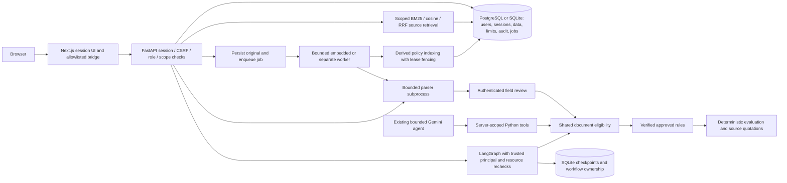

# Architecture — 2026-10-30

M4 adds organization/policy-scoped source search, separate fenced `policy_index` jobs
and derived `PolicySearchIndex`/`SearchPassage` tables. SQL authorization precedes
BM25/vector ranking; current chunk hashes/offsets are revalidated on reads. Optional local
ONNX vectors use BM25/cosine/RRF; default is explicit keyword search. The legacy global
FAISS experiment remains outside the product path. Existing approved-rule evaluation
and agent authority boundaries remain. See [design and limits](RETRIEVAL.md) and ADR 011.

## Current data and trust flow

`app/auth/security.py` authenticates sessions and scopes each business request.
Documents have organization/owner fields; policies are organization-shared, with staff
write permission. Reviewer identities come from sessions. Users/sessions, counters,
security events and workflow ownership records are in the business database. Checkpoints
remain separate SQLite state; APIs check workflow and linked resources before reading them.
Graph nodes receive trusted server principals through their builders, never browser state.

Uploads use byte/structure limits and a disposable parser; model extraction is bounded
and can fall back. `app/review/eligibility.py` shares schema/review gates across API, tools
and graph. Auto-accepted classification still needs human review. Fallback must be corrected;
original extraction provenance and before/after snapshots are retained. Missing money,
currency, approved rules or source evidence produces review/abstention.

Rule activation requires source verification and an authenticated human decision.
The transition is atomic under competing reviews. Approved-rule loading rechecks quotations
against the selected policy's source chunks. Gemini selects only three scoped tools;
its draft is excluded from authoritative answers. Field review, rule approval and actual
expense approval are distinct. No expense approval/payment implementation is claimed.

Next.js forwards only credential/CSRF/origin metadata to a fixed backend, never client
roles or resource grants. Query data is cleared on logout. Policy discovery is server-backed;
reviewers can extract/decide rules, and admins can create/disable local accounts.
Development investigation/workflow/rule-review guards remain additional restrictions.
The production frontend investigation gateway remains disabled. In development the page
loads scoped documents/policies and sends a selected pair with the question. The backend
derives permissions from the session and rechecks each selection, then supplies only that
pair to the bounded agent's tools. No environment ID lists are required or consulted.
See [security](SECURITY.md).

Policy upload persists the original/resource/job before automatically parsing, chunking
and calling the whole-policy extractor in the worker. One model call sees all chunks (at most 30,000 source
characters) and proposes up to 100 rules. Each rule passes the existing deterministic
source verifier; unsupported drafts are excluded and valid candidates remain pending.
Stable content-derived identity deduplicates retries without overwriting decisions.
Bulk approval reuses the single-rule verifier with deferred commits: all explicit IDs
and their review events commit together, or every change rolls back. No AI approval.

The profile API computes personal activity using tenant-scoped SQL aggregates; role
controls the returned metrics. Names are display metadata, never authorization grants.
Audit data retains stable actor IDs, with current same-organization names resolved for
display. Password changes verify the existing Argon2 hash, conditionally replace it,
revoke all old sessions and issue a new current-browser credential. No new dependency.

## Persistence and migration

Default database `data/database.db`, originals `data/uploads`/`data/policies`, checkpoints
`data/langgraph_checkpoints.sqlite`; paths resolve from the backend working directory.
`EDI_DATABASE_URL` is an explicit process variable. Startup no longer calls `create_all`.
Alembic's frozen adoption revision supports fresh or recognized legacy schemas; legacy
records receive a quarantined scope and no inferred ownership. Real data adoption has
not been performed. Tests cover fresh/repeated upgrade, synthetic legacy preservation
and model/schema consistency. Unknown legacy shapes fail preflight.

PostgreSQL uses psycopg and native atomic upserts; SQLite remains available for local
development. Default ingestion is queued with an embedded worker, or a separate worker
in Compose. Claims have bounded attempts, delays and fenced leases; business writes and
job completion commit together. A reclaimed job cannot be overwritten by a stale worker.
Original-file writes and database transactions are not a distributed transaction: failed
intake/import can leave unreferenced files, but cannot establish a false completed outcome.
LangGraph keeps its existing SQLite saver on the persistent file volume; business records
and workflow ownership can be PostgreSQL. This deliberately avoids an unnecessary saver
migration or extra broker for the current single-host configuration. See [operations](PERSISTENCE.md).

## Target and measured limits

Keep FastAPI, Next.js, Gemini tools and LangGraph. PostgreSQL/Alembic, safe SQLite import
and durable jobs are implemented. Next add authorized full-text
plus pgvector retrieval and measured specialist cooperation. Redis/reranking/extra
services require a measured need. Existing global FAISS and model-led RAG are experimental;
the retired legacy endpoint returns 410 and does not expose those decisions.

Hardware audit: 4 logical CPUs, about 8 GB RAM. Prefer remote inference, serial heavy
checks and bounded parser/worker concurrency. Docker was unavailable on PATH at initial
audit. Parser subprocesses have deadlines/input limits, not an OS permission sandbox.
Container budgets/private networking and readiness are defined and locally verified:
both images built cleanly, both profiles started and preserved data across full-service
restarts. Production backups/restore rehearsal, deployment,
retention, SSO and operational telemetry remain unfinished. Arabic Unicode/OCR/RTL
foundations are present; semantic support and measured OCR/field/retrieval quality remain
required release gates. Source verification is still narrow English monetary-rule support.
